# TP-3 : Configuration et utilisation de VNC


**Université Cheikh Anta Diop**  
**École Supérieure Polytechnique**  
**Département Génie Informatique**  
**Année universitaire 2026-2027**  
**Licence Génie Logiciel et Systèmes d’Information (LGLSI, 3e année)**  
**Services Réseaux Avancés**  
**Travaux pratiques**

## Informations

- **Classe :** L3 GLSI A
- **Étudiant :** Mahuna Olympe ATCHATIN
- **Enseignant :** Dr Keba GUEYE

## Partie 1 : Installation et configuration du serveur VNC

### 1. Mise à jour de la machine

```bash
sudo apt update && sudo apt upgrade -y
```

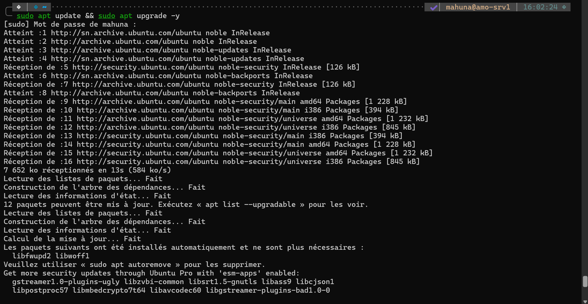

### 2. Installation du serveur VNC

On installe TigerVNC :

```bash
sudo apt install tigervnc-standalone-server -y
```

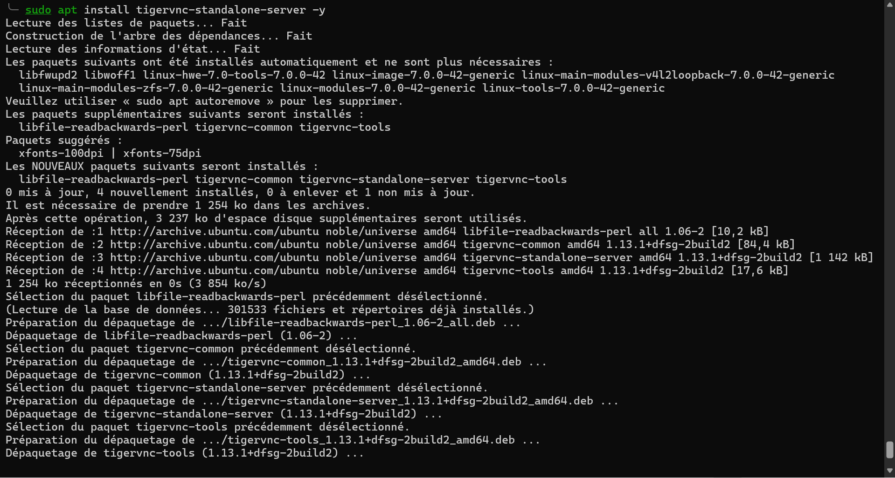

### 3. Configuration de l’environnement de bureau

```bash
sudo apt install xfce4 xfce4-goodies -y
```

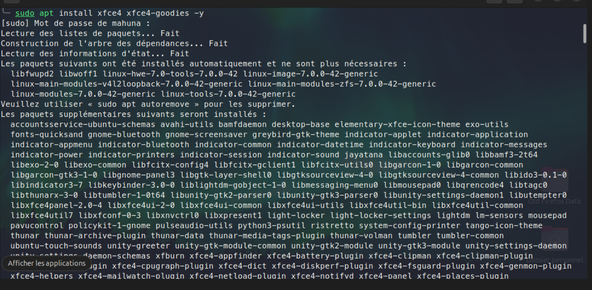

Pendant l’installation, on nous demande quel gestionnaire d’affichage garder. On garde **gdm3**, celui d’Ubuntu par défaut, pour ne rien changer à la VM.

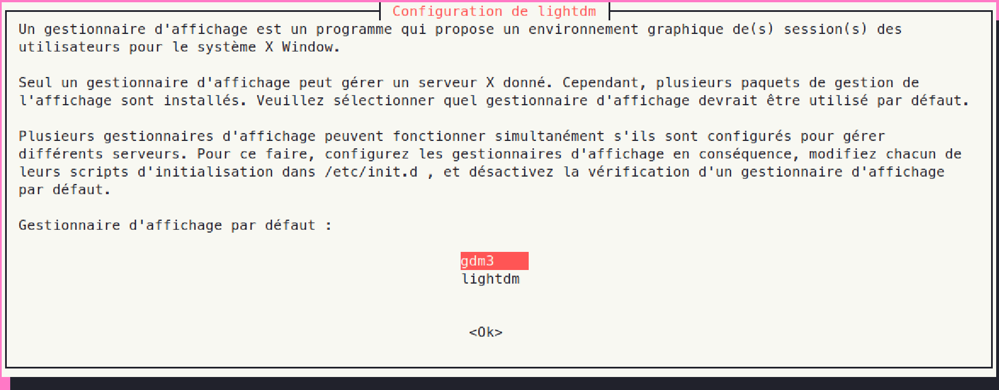

### 4. Initialisation du serveur VNC

On démarre le serveur VNC pour créer la configuration initiale.

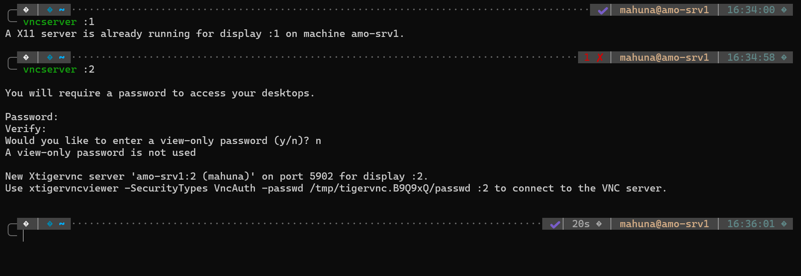

Le port 5901 étant déjà occupé, on utilise le 5902.

### 5. Arrêter le serveur pour la configuration avancée

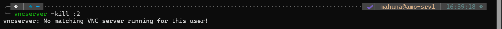

### 6. Personnaliser le fichier de configuration

On édite le fichier de configuration `~/.vnc/xstartup`.

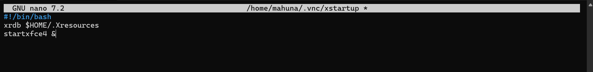

Puis on s’assure que le script est exécutable.

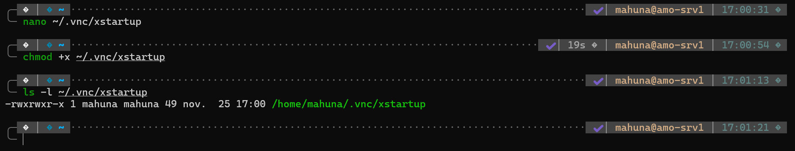

### 7. Relancer le serveur VNC

**Problème :** une fois lancé, le serveur s’arrêtait automatiquement.

Sur Ubuntu 24.04, TigerVNC considère que la session graphique dure aussi longtemps que le script `xstartup`. Dès que ce script se termine, il arrête le serveur VNC. Or, à cause du `&`, la commande `startxfce4` est lancée en arrière-plan : le script n’attend pas XFCE et se termine immédiatement. TigerVNC conclut que la session est finie et arrête le serveur.

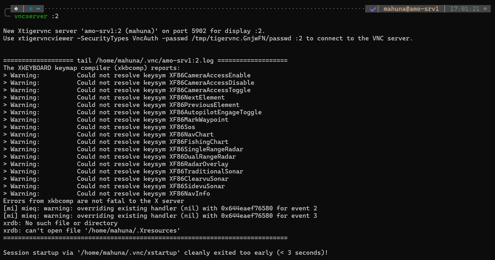

**Solution :** `exec startxfce4` remplace `startxfce4 &` : le script est remplacé par XFCE au lieu de se terminer. La session reste ouverte tant que XFCE tourne.

- Les deux lignes `unset` retirent les variables de la session GNOME déjà ouverte, pour éviter que XFCE tente de s’y rattacher (ce qui donne un écran noir ou gris).

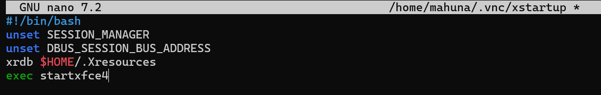

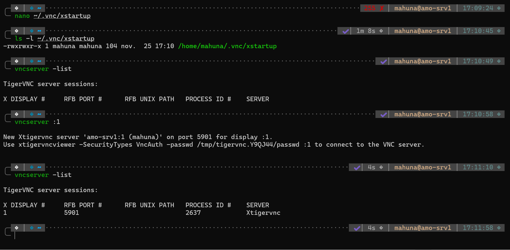

Le serveur est maintenant lancé.

## Partie 2 : Connexion depuis une machine cliente

### 1. Installation du client VNC sur la machine cliente

On installe VNC Viewer sur la machine cliente Windows.

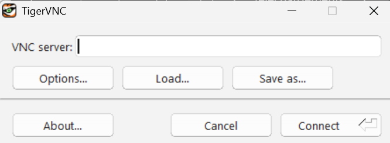

### 2. Connexion au serveur

On ouvre TigerVNC, puis on renseigne l’IP du serveur ainsi que le numéro de port utilisé.

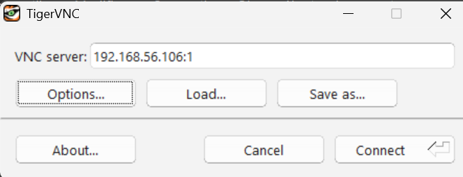

**Problème :** le client affiche une erreur de connexion. Après analyse, il s’est avéré que TigerVNC applique par défaut l’option `localhost=yes`, ce qui fait que le serveur n’écoute que sur l’adresse locale.

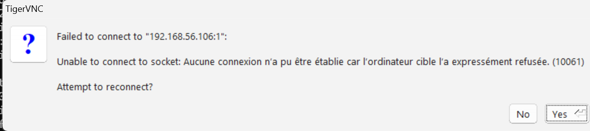

**Solution :** on tue le processus en cours, puis on le relance avec l’option `localhost` à `no` :

```bash
vncserver -kill :1
vncserver :1 -localhost no -geometry 1600x900
```

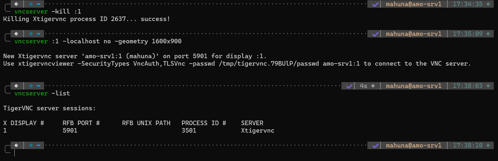

On retente ensuite la connexion depuis le client. Elle passe cette fois-ci, et on renseigne le mot de passe défini au premier lancement de VNC.

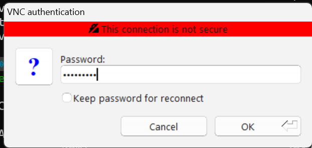

### 3. Test de la connexion

Une fois connecté, l’environnement de bureau du serveur apparaît. On peut alors tester les interactions.

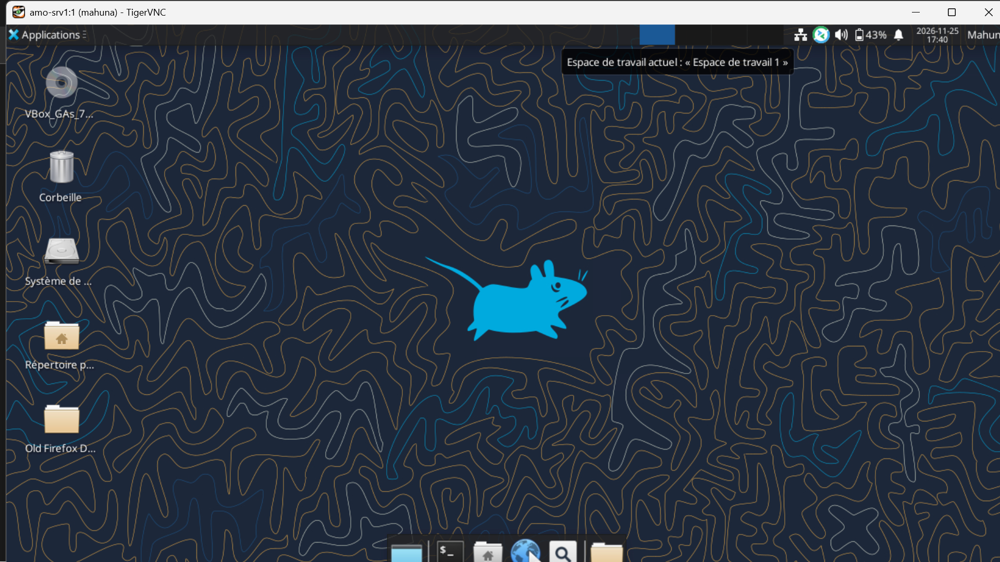

## Partie 3 : Sécurisation de la connexion VNC avec un tunnel SSH

### 1. Configuration du tunnel SSH

Avant de créer le tunnel, on relance le serveur VNC avec l’option par défaut `localhost` à `yes`. Puis on crée le tunnel SSH.

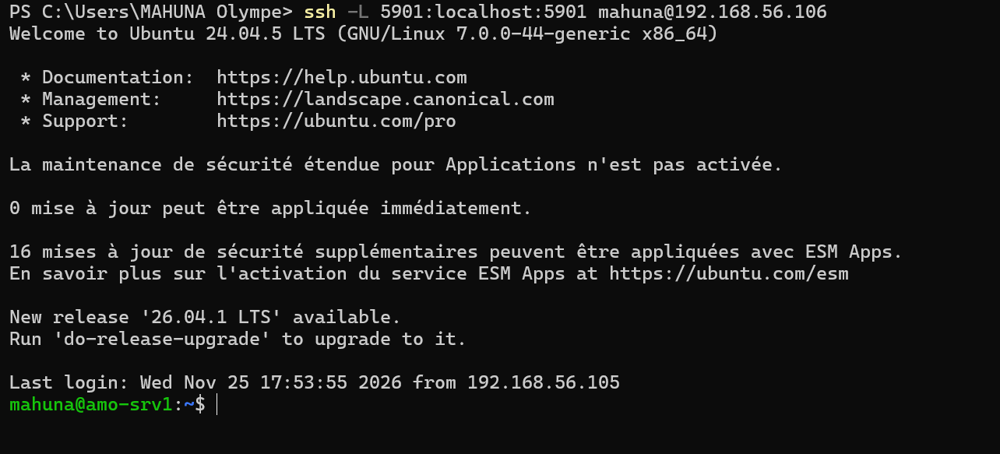

### 2. Connexion au serveur VNC via le tunnel

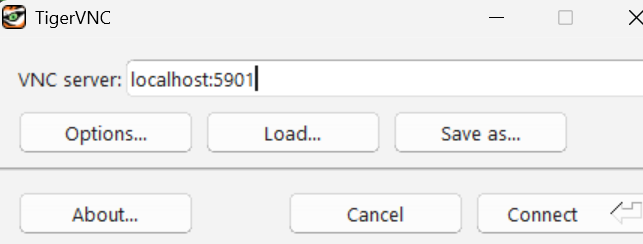

On renseigne ensuite le mot de passe du serveur VNC et l’écran de la VM s’affiche.

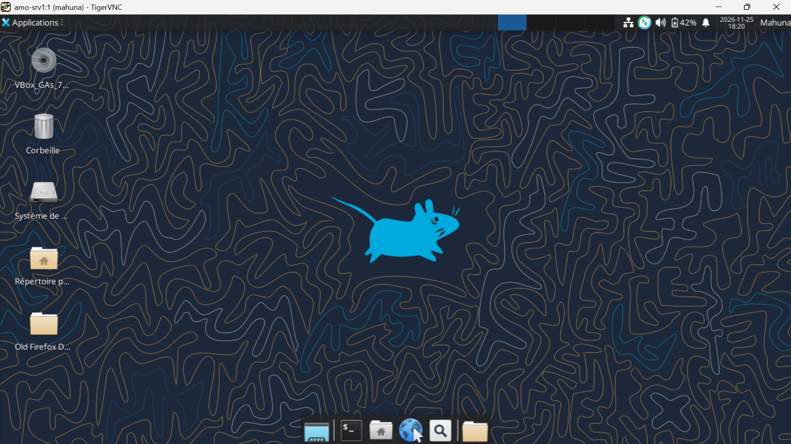

### 3. Vérifier le chiffrement

En consultant les journaux SSH, on constate que la connexion est bien chiffrée.

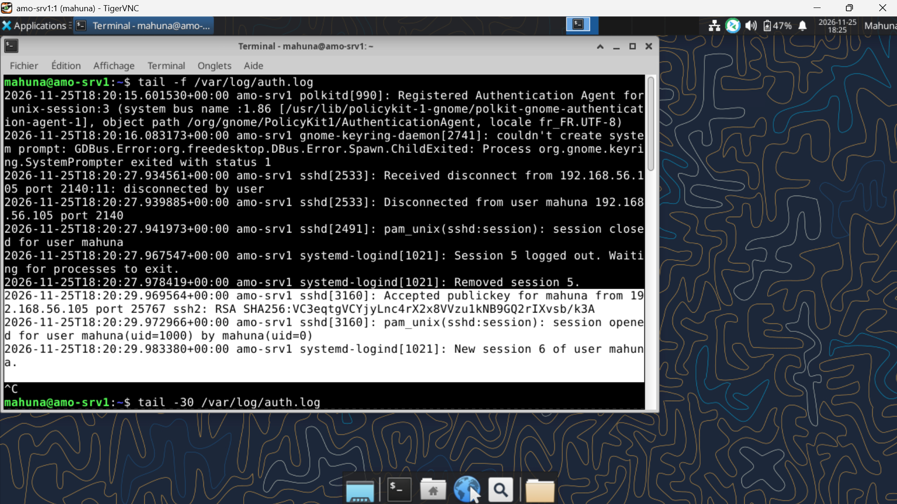
