# TP-4 : Mise en place d’un accès noVNC pour le contrôle à distance via un navigateur web


**Université Cheikh Anta Diop**  
**École Supérieure Polytechnique**  
**Département Génie Informatique**  
**Année universitaire 2026-2027**  
**Licence Génie Logiciel et Systèmes d’Information (LGLSI, 3e année)**  
**Services Réseaux Avancés**  
**Travaux pratiques**

## Informations

- **Classe :** L3 GLSI A
- **Étudiant :** Mahuna Olympe ATCHATIN
- **Enseignant :** Dr Keba GUEYE

## Étape 1 : Installation du serveur VNC et de noVNC

### 1. Mise à jour du système

```bash
sudo apt update && sudo apt upgrade -y
```

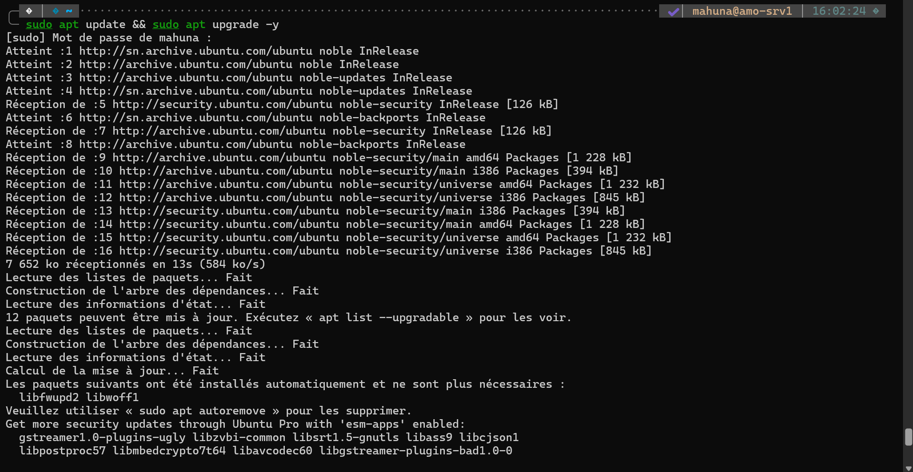

### 2. Installation du serveur VNC

Le serveur VNC est déjà installé sur le serveur : pas besoin de le réinstaller.

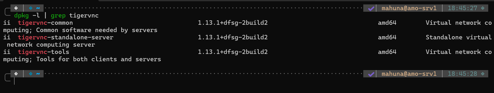

### 3. Installation de noVNC

D’abord, on installe git :

```bash
sudo apt install git -y
```

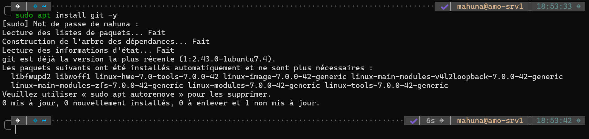

Ensuite, on clone le dépôt git de noVNC dans le dossier `/opt`.

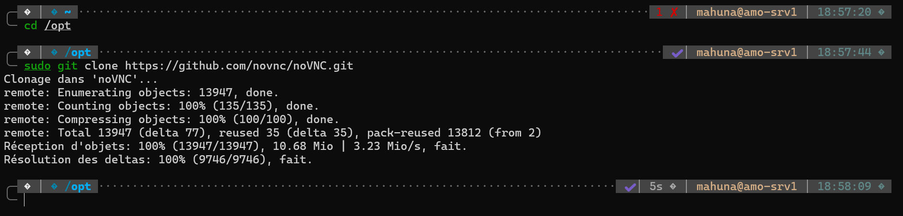

On vérifie le contenu du répertoire pour s’assurer que tout est bien installé.

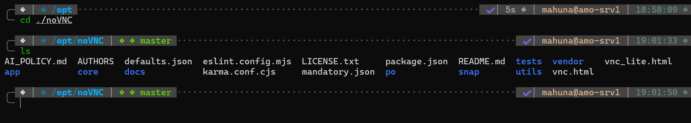

### 4. Installation de Websockify

```bash
sudo apt install python3-pip -y
sudo pip3 install websockify
```

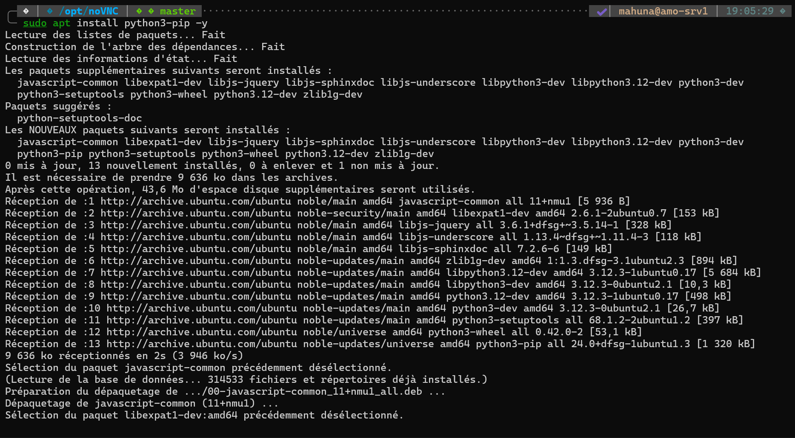

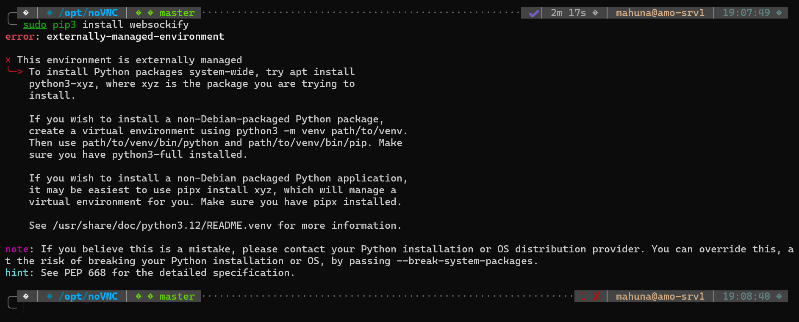

**Problème :** la deuxième commande (`sudo pip3 install websockify`) échoue et renvoie une erreur : le système interdit à pip de modifier le Python dont Ubuntu a besoin. On utilise donc le paquet Ubuntu, qui installe le même outil :

```bash
sudo apt install websockify -y
```

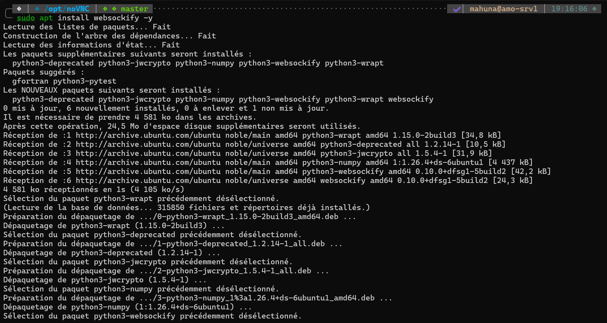

## Étape 2 : Configuration du serveur VNC

1. Lancer une session VNC
2. Configurer le fichier `xstartup`
3. Redémarrer la session VNC

Le serveur VNC ayant déjà été configuré lors du TP précédent ([TP-3 : VNC](TP3_VNC_rapport.md)), cette configuration n’est pas reprise ici. On relance simplement le serveur.

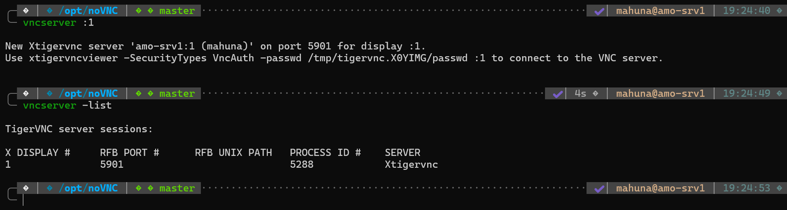

## Étape 3 : Lancer noVNC et configurer le service web

### 1. Lancer Websockify pour le tunneling

```bash
./utils/novnc_proxy --vnc localhost:5901
```

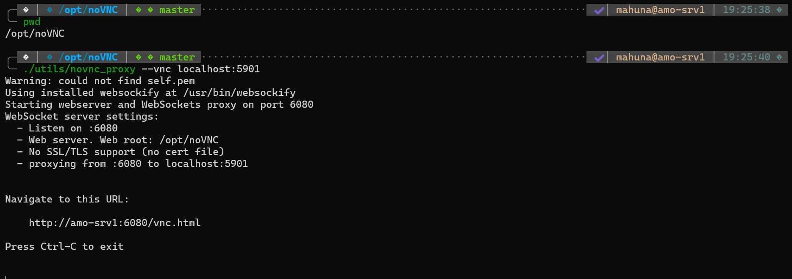

### 2. Accéder à noVNC via le navigateur

On accède à noVNC depuis le navigateur via l’URL `http://192.168.56.106:6080/vnc.html`.

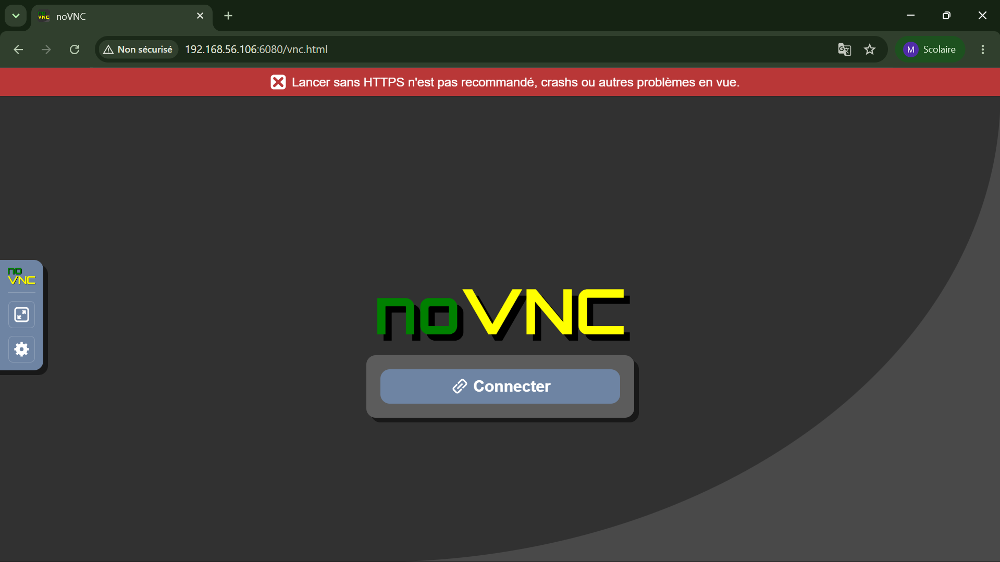

On se connecte ensuite avec le mot de passe du serveur VNC, et l’interface du serveur s’affiche dans le navigateur.

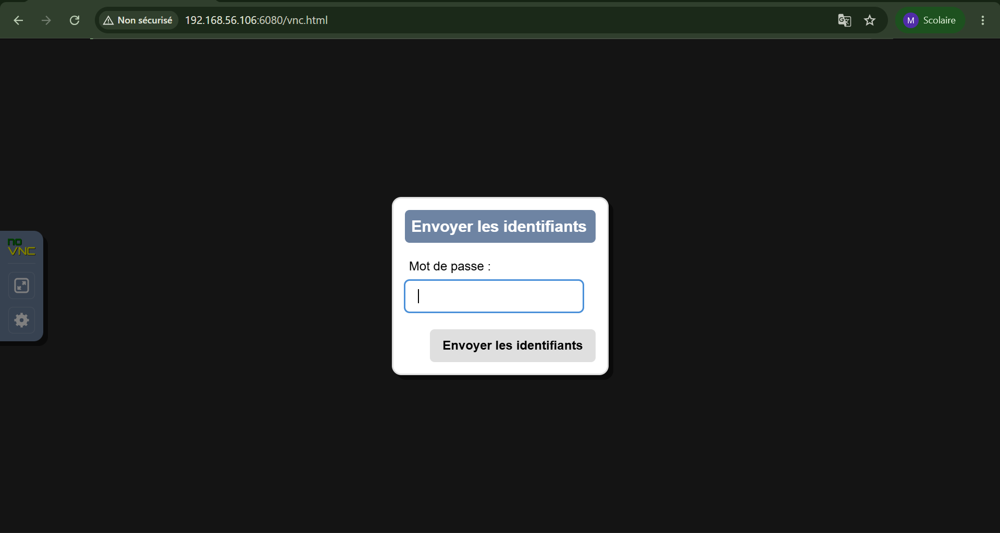

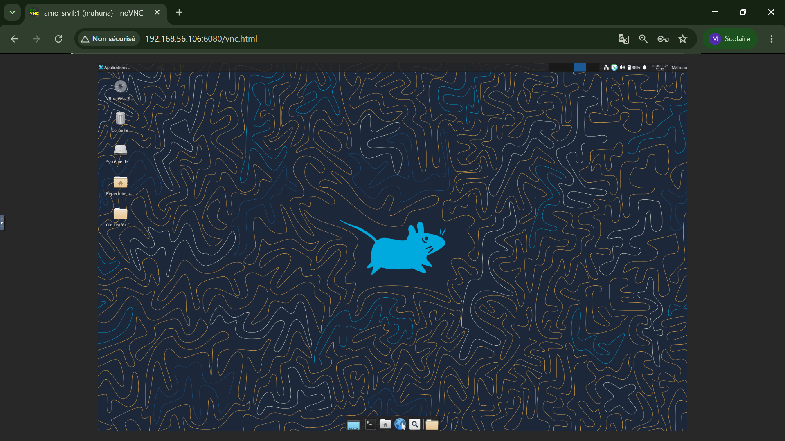

## Étape 5 : Sécuriser la connexion avec un tunnel SSH (optionnel)

On crée un tunnel SSH :

```bash
ssh -L 6080:localhost:6080 mahuna@192.168.56.106
```

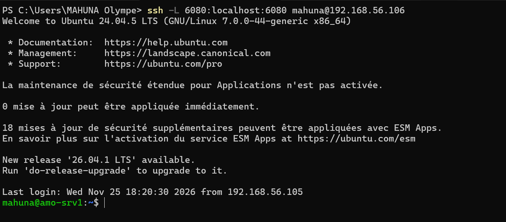

On accède ensuite à noVNC depuis le navigateur avec l’adresse `http://localhost:6080/vnc.html`.

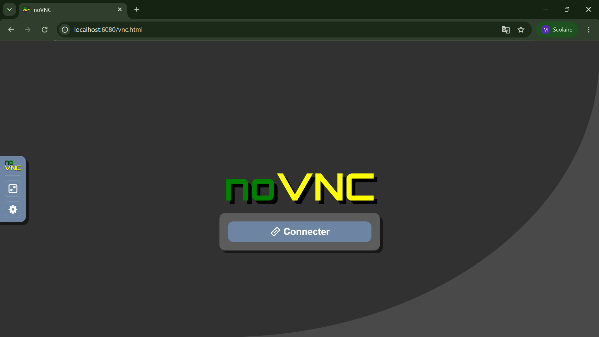

## Étape 6 : Tests et vérification

### 1. Connexion VNC

On se connecte à VNC via le navigateur, puis on teste les fonctionnalités.

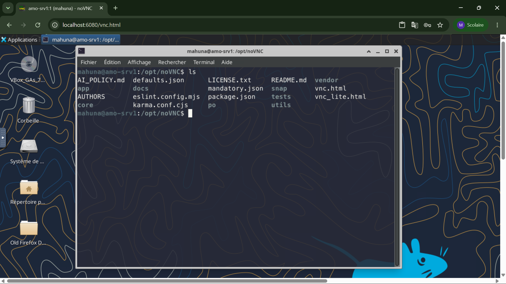

### 2. Stabilité du service

Après un redémarrage, ni le serveur VNC ni noVNC ne sont actifs. Comme le montre la capture ci-dessous, aucun processus n’écoute sur le port 5901 (utilisé pour VNC) ni sur le port 6080 (utilisé par Websockify).

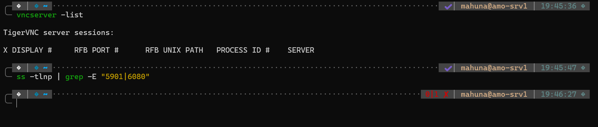

## Questions de réflexion

### Utilité de Websockify dans une architecture noVNC

Un navigateur web ne peut pas ouvrir directement une connexion TCP vers un serveur VNC : il ne communique qu’en HTTP et en WebSocket. Or le serveur VNC (TigerVNC) utilise le protocole RFB sur une connexion TCP classique (port 5901). Websockify sert de passerelle entre les deux :

- il reçoit la connexion WebSocket du navigateur (port 6080) ;
- il la convertit en connexion TCP vers le serveur VNC (`localhost:5901`) ;
- il fait la conversion inverse pour les données renvoyées par le serveur.

### Différences entre noVNC et les clients VNC standards

| Critère | noVNC | Client VNC standard (TigerVNC Viewer, RealVNC) |
|---|---|---|
| Type | Application web en HTML5/JavaScript | Application native à installer |
| Exécution | Dans le navigateur | Sur le système d’exploitation |
| Connexion au serveur | Via WebSocket, avec un proxy (websockify) | Directe, en TCP, avec le protocole RFB |
| Installation côté client | Aucune | Logiciel à télécharger et installer |
| Port utilisé (dans ce TP) | 6080 | 5901 |

### Avantages et inconvénients de noVNC par rapport à une application VNC native

**Avantages :**

- Aucune installation sur le poste client : un navigateur suffit.
- Multiplateforme : fonctionne sur Windows, Linux et macOS.
- Passe plus facilement les pare-feu, puisqu’il utilise des protocoles web (HTTP, WebSocket) souvent autorisés.
- Peut être sécurisé en HTTPS (WebSocket chiffré), ou via un tunnel SSH comme dans ce TP.

**Inconvénients :**

- Un composant supplémentaire (websockify) à installer, maintenir et sécuriser côté serveur.
- Performances généralement inférieures à celles d’un client natif, car tout passe par le navigateur et le proxy.
- Moins de fonctionnalités que certains clients natifs (options d’encodage, transfert de fichiers, etc.).
- Exposition web : sans HTTPS ni tunnel, le trafic n’est pas chiffré, et le service est accessible à quiconque connaît l’URL et le mot de passe.
